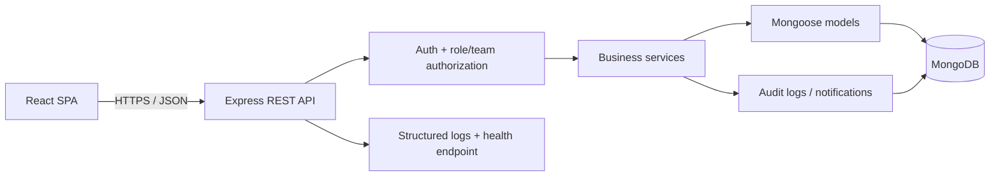

# StaffSync Architecture (Phase 1)

## Decision summary

| Concern | Decision | Rationale |
|---|---|---|
| Runtime | Node.js 24 LTS | Use a supported LTS line rather than an obsolete runtime. |
| Frontend | React + Vite, JavaScript ES modules | Fast local development and static production build. |
| UI | Bootstrap 5 + Bootstrap Icons + project CSS tokens | Responsive foundation with reusable components. |
| Navigation | React Router | Role-aware route grouping and protected navigation. |
| Client state | Redux Toolkit + React Redux | Central authentication and cross-page state. |
| Forms and feedback | React Hook Form + React Hot Toast | Consistent validation and status feedback. |
| Charts | Recharts | Dashboard and report visualizations. |
| API | Express 5, REST under `/api/v1` | Versioned, conventional backend interface. |
| Persistence | MongoDB + Mongoose | Document persistence with schema validation, indexes and references. |
| Authentication | Short-lived access JWT + rotating, revocable refresh session in HttpOnly cookie | Avoid persistent bearer tokens in localStorage; configure cookies and CSRF defenses for the actual deployment origin. |
| Validation | Zod at request boundaries | Shared validation conventions and clear error responses. |
| Security | Helmet, explicit CORS, rate limiting, bcryptjs, centralized authorization | Defense in depth; role enforcement remains server-side. |
| Tests | Vitest + Supertest, React Testing Library | Unit/integration coverage for backend and frontend workflows. |
| Logs | Pino / pino-http | Structured, redacted application logs. |

## Context and request flow



The frontend is a presentation and interaction layer. No permission decision is trusted solely because a button or route is hidden in React. The API derives the authenticated user from validated credentials, then checks role, record ownership and manager-team membership before returning or mutating records.

## Proposed data relationships

- `User` 1:0..1 `Employee`: authentication identity and business profile are separate. `User` stores `passwordHash`, role and account state; `Employee` stores employment details.
- `Employee` 1:N `Attendance`: a unique compound index on `(employee, workDate)` prevents duplicate daily records.
- `Employee` 1:N `LeaveRequest`; `LeaveRequest.reviewer` references a `User`. Overlap checks cover pending and approved requests.
- `Employee.manager` references an `Employee`, which defines a manager's current team. Team authorization queries must use this relationship on the server.
- `User` 1:N `Notification`; notification reads/updates are scoped to the recipient.
- `Announcement.author` and `Training.createdBy` reference `User`.
- Training participation is represented by enrollment records with status and completion metadata; duplicate enrollment is prevented by a unique participant key or equivalent atomic operation.
- Optional `AuditLog` records actor, action, entity type/id, timestamp and redacted metadata. It must not store passwords or raw tokens.
- A refresh-session collection stores hashes of refresh tokens, family/rotation metadata, expiry and revocation state; raw refresh tokens are never stored.

## API response envelope

Success:

```json
{
  "success": true,
  "data": {},
  "meta": { "page": 1, "limit": 20, "total": 0, "pages": 0 }
}
```

Errors:

```json
{
  "success": false,
  "error": {
    "code": "VALIDATION_ERROR",
    "message": "The request could not be validated.",
    "details": []
  },
  "requestId": "..."
}
```

`meta` is omitted when not applicable. Errors should not expose stack traces, secrets or internal database messages in production.

## Authentication lifecycle

1. Login verifies the normalized email, account status and bcrypt password hash.
2. The API returns a short-lived access token; the frontend keeps it in memory (Redux state), not localStorage.
3. A refresh token is issued only as an HttpOnly cookie. The backend stores only its hash and rotates it on refresh; reuse revokes the associated token family.
4. On reload, the client calls `/auth/refresh` to restore authentication state. Logout revokes the refresh session and clears the cookie.
5. For cookie-authenticated mutations, enforce an origin/CSRF strategy. Production cross-site cookie deployment requires HTTPS, `Secure`, an intentional `SameSite` policy, exact CORS origins and credentials.
6. HR/Manager account provisioning is private. There is no public endpoint that lets a caller self-register with an elevated role.

## Time and attendance policy

Use UTC timestamps in persistence and ISO 8601 over the API. A configured `APP_TIMEZONE` determines the work date and business-day boundaries. Do not infer holidays or weekend policy: configure those rules in a later implementation phase and document them before production use. Store a unique work-date key per employee and reject duplicate check-ins, invalid check-outs, and checkout-before-checkin.

## Deployment topology

- Frontend: static assets on Vercel or Netlify.
- API: a Node.js hosting service that supports environment variables and graceful process shutdown.
- Database: MongoDB Atlas or a protected MongoDB deployment.
- Use TLS/HTTPS in production, allow only the intended frontend origin, limit database network access, and configure secrets in the hosting platform.
- If multi-document workflows require MongoDB transactions, use a replica set (MongoDB Atlas provides this) and document that prerequisite.

## Architecture boundary for Phase 1

This phase creates the architecture decisions and a bootable frontend/backend foundation. Feature APIs, Mongoose models, authentication workflows, role checks, tests and database integration are intentionally assigned to later phases and are not represented as complete here.

## Upstream compatibility references

- Node.js release schedule: https://github.com/nodejs/Release (Node 24 is listed as Active LTS in the checked schedule).
- React version page: https://react.dev/versions (React 19.3 is listed as latest in the checked page).
- Vite guide: https://vite.dev/guide/ (check the current Node compatibility note before updating the toolchain).
